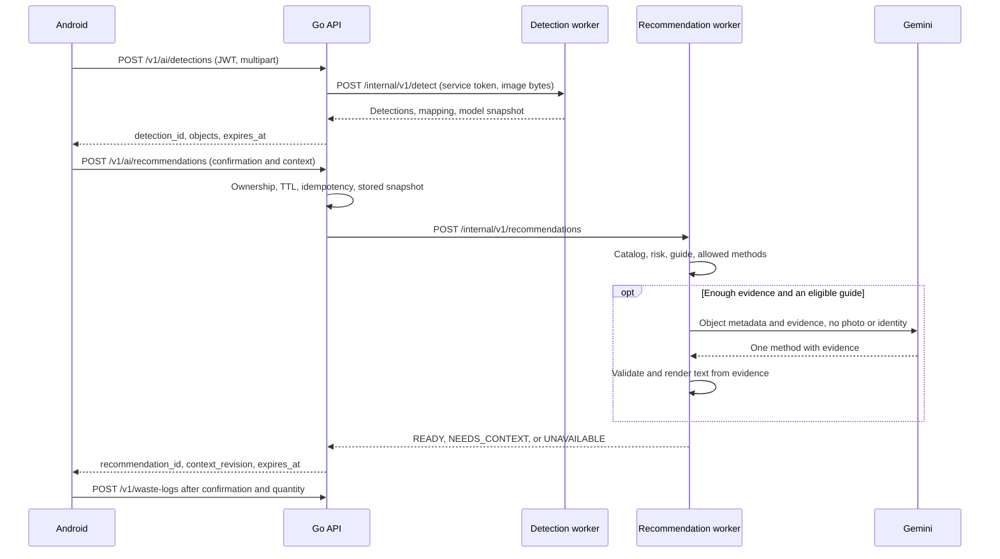

# AI HTTP Contract v1

This document defines how the Android app, the Go backend, and the Python AI workers divide responsibilities, and which contract artifacts each consumer relies on.

## Contract artifacts

All artifacts live in [`contracts/v1`](../contracts/v1) and are generated from the Python models. Never edit them by hand.

| Artifact | Consumer |
|---|---|
| [`public.openapi.json`](../contracts/v1/public.openapi.json) | Go and Android: the four public `/v1/ai/*` endpoints |
| [`private-detection.openapi.json`](../contracts/v1/private-detection.openapi.json) | Go → detection worker |
| [`private-recommendation.openapi.json`](../contracts/v1/private-recommendation.openapi.json) | Go → recommendation worker |
| [`errors.json`](../contracts/v1/errors.json) | HTTP status, stable code, message, and retryability for every error |
| [`examples/`](../contracts/v1/examples) | Requests and responses for each method, missing context, errors, and detection references |

In the source, `wire.py` defines the transport schema and `decisions.py` defines the decision interface. `recommendation.py`, `catalog.py`, and `providers.py` implement the rules.

After an intentional change, regenerate the artifacts and check them:

```sh
make export-contracts   # regenerate
make contracts          # verify generated files and the backend pin
```

CI validates the three OpenAPI documents, checks every example against its JSON Schema, and fails on any drift between source and artifacts. It needs no YOLO weights, API keys, or Gemini calls.

## Conventions

- **Envelope.** Responses carry `api_version` `1.0.0`, and public URLs use the `/v1` prefix.
- **JSON values.**
  - Fields are `snake_case`.
  - IDs are UUID strings.
  - Timestamps are RFC 3339 in UTC.
- **Bounding boxes.** Use `[xmin, ymin, xmax, ymax]`, normalized to 0–1 against the image after orientation correction.
- **Enums.** Categories and methods are enums, not display text.
- **Object keys.** Object keys are stable; display labels may change without changing them.
- **Guide and evidence IDs.** These are strings and are not always UUIDs.
- **Additive changes.** New optional fields may be added within `1.0.0`. Consumers must ignore unknown fields. Breaking changes require a new version.

## Ownership

| Component | Owns | Does not own |
|---|---|---|
| Detection worker | Image decoding and orientation, model checksum, bounding boxes, per-class thresholds and confidence bands, class-to-catalog mapping, model capabilities | Accounts, databases, Gemini keys |
| Recommendation worker | Object and category validation, risk propagation, guide selection and expiry, allowed methods, Gemini calls and key pool, evidence validation, reasons, steps, sources, policy version | Sessions, ownership, storage |
| Go backend | JWT and ownership, feature flags, per-account rate limits and budgets, sessions and TTL, durable deduplication, provenance snapshots, waste log and XP transactions, structural validation of worker responses | Mapping, evidence, prompts, or handling rules |
| Android app | Camera, consent to send, object selection and correction, context input, displaying results, confirming saves | Choosing sources or allowed methods; calling workers or Gemini directly |

## Request flow



## Private endpoints

| Worker | Endpoint | Body |
|---|---|---|
| Detection (port 8091) | `POST /internal/v1/detect` | Raw JPEG or PNG bytes |
| Detection | `GET /internal/v1/capabilities` | |
| Recommendation (port 8093) | `GET /internal/v1/objects` | |
| Recommendation | `POST /internal/v1/recommendations` | JSON, at most 16 KiB |
| Both | `GET /health/ready` | |

- **Authentication.** Every request needs `Authorization: Bearer <service-token>`. Each worker has its own token, and the detection worker strips Gemini keys and the recommendation token from its environment at startup.
- **Request IDs.** Go may send a UUID `X-Request-ID` for correlation.
- **Caching.** Errors and private responses use `Cache-Control: no-store`.
- **Network exposure.** Both workers bind to loopback by default and expose neither HTTP docs nor access logs.
- **Image limits.** At most 5 MiB, 12 megapixels, and 4096 px per side.
- **Concurrency.** Each process runs one job at a time. A busy worker returns `503` with `Retry-After`, and a missed deadline returns `504`.
- **Deadline overruns.** A native inference or provider call that overruns its deadline keeps its slot until it finishes.
- **Legacy route.** `/internal/detect` remains as a compatibility route. New integrations must use the versioned routes.

### Detection snapshot

Go builds the `selection` field of a recommendation request from the detection result it stored. The snapshot contains:

- `model_version`, `model_sha256`, and `mapping_version`;
- `class_names`;
- the chosen object.

The public endpoint never accepts these fields from Android. The recommendation worker rechecks the label, mapping, thresholds, and risk even after the user corrects an object. For manual input, `selection` is `null`. See [`internal-recommendation-request.json`](../contracts/v1/examples/internal-recommendation-request.json).

## Go adapter obligations

1. **Snapshots.** Load the catalog from the recommendation worker and the capabilities from the active detection worker. Store their versions and checksums together, and refresh both when the model or mapping changes.
2. **Validation before inference.** Validate the JWT, media size, and quota before inference. Parse worker responses against the schema, and store the user's detection metadata for the session TTL.
3. **Recommendation checks.** Check ownership and expiry before using the cache or calling a worker. Reject client fields outside `RecommendationInput`, such as `confidence`, `raw_class`, `guide`, `allowed_methods`, `provider`, or `user_id`.
4. **Idempotency.** Store idempotency keys atomically, scoped to `(user, operation, client_request_id)`.
   - A different canonical digest returns `409`.
   - Concurrent identical requests share one job.
   - An identical replay returns the same ID, expiry, and data.
5. **No hidden retries.** The private recommendation endpoint is stateless and does not deduplicate provider calls. Go tracks `IN_PROGRESS`, `COMPLETED`, and `FAILED_UNCERTAIN`.
   - When a transport timeout leaves the outcome unknown, store the uncertainty instead of silently resending.
   - A new generation requires an explicit user action and a new `client_request_id`.
6. **Wrapping decisions.** Wrap each decision with `recommendation_id`, `category`, `confirmed_object_key`, `context_revision`, and an `expires_at` no later than the detection session's. Never change the method, add evidence, or replace `UNAVAILABLE` with advice generated by Go.
7. **Session deletion.** Deleting a session invalidates its recommendations, including replays. A late result never revives a deleted session.
8. **Storage.** `POST /v1/waste-logs` is the only storage path. It confirms the object and method, takes a manual quantity, and links the recommendation once, all in one transaction. Recommendations never award XP.

## Client obligations

- **Confirmation fields.** `confirmed_object=true` must be set explicitly. `input_source=DETECTION` requires both the detection ID and the object ID; `MANUAL` sends neither.
- **Context revisions.** Increase `context_revision` whenever the selection or conditions change. Send a new request UUID, and discard responses that do not match the current detection ID or revision.

| Result | Client behavior |
|---|---|
| `REVIEW_REQUIRED` | Show boxes or a list with the server's confidence band, and ask the user to confirm the material |
| `MANUAL_REQUIRED` | Offer catalog selection or a retake; never invent a detection |
| `READY` | Show one method with its scope, reason, steps, sources, and cautions, then wait for the user to confirm saving |
| `NEEDS_CONTEXT` | Render the fields in `missing_context` and keep the other inputs; the method and scope are `null` |
| `UNAVAILABLE` | Show the `reason_code`, cautions, and sources, then offer manual entry or an explicit retry |
| `401`, `404`, `409`, `410` | Handle the session, login, or conflict according to the error code, and keep the draft |
| `429`, `503`, `504` | Respect `Retry-After`; never retry in a loop or swap the UUID automatically |

`201` means a session or a first `READY` result was created. `200` means a replay, or a `NEEDS_CONTEXT` or `UNAVAILABLE` result. `204` is a delete with no body. An HTTP `200` does not mean a recommendation is ready.

## Policy fields

The current policy adds these optional fields:

| Field | Location |
|---|---|
| `condition.former_contents` | Request condition. Values: `FOOD_DRINK`, `CHEMICAL`, `OTHER`, `UNKNOWN` |
| `review_profile` | Results and capabilities |
| `review_thresholds`, `review_reasons`, `ambiguous_with` | Each detected object |
| `class_thresholds`, `review_only_classes` | Capabilities and the merged catalog |

- **Model profiles.** For a registered checkpoint, Go must send `model_sha256` in the private `selection` so replays apply the same thresholds. A profiled mapping without matching provenance is rejected.
- **Recycling access.** A pilot `RECYCLE` result requires confirmed collector access.
- **HDPE contents.** HDPE needs `former_contents=FOOD_DRINK`. `UNKNOWN` returns `NEEDS_CONTEXT`, and a chemical history blocks the regular rules even when the item looks clean.

## Mock server

The mock implements the public contract without YOLO, Gemini, or a database. It is for frontend and backend development only.

```sh
PYTHONPATH=src python -m wastenot_ai.cli serve-mock --port 8094
```

Open <http://127.0.0.1:8094/docs> and authorize as `mock-user-a` or `mock-user-b`. These are fixture identities; the mock does not verify JWTs.

- **Responses.** Every response carries `X-WasteNot-Mock: true`. Recommendations use `provider=fixture` and `prototype_only=true`.
- **State.** State lives in memory: 64 sessions and 128 replays, each with a 24-hour TTL. A restart clears it.
- **Scenarios.** Choose one at startup with `--scenario`:

| Scenario | Behavior |
|---|---|
| `normal` | Real Python rules with the fixture provider |
| `uncertain` | Low-confidence detections |
| `no-detections` | Empty detection result |
| `provider-unavailable` | `200` with an `UNAVAILABLE` result |
| `rate-limited` | `429` with `Retry-After: 30` |
| `timeout` | `504` |
