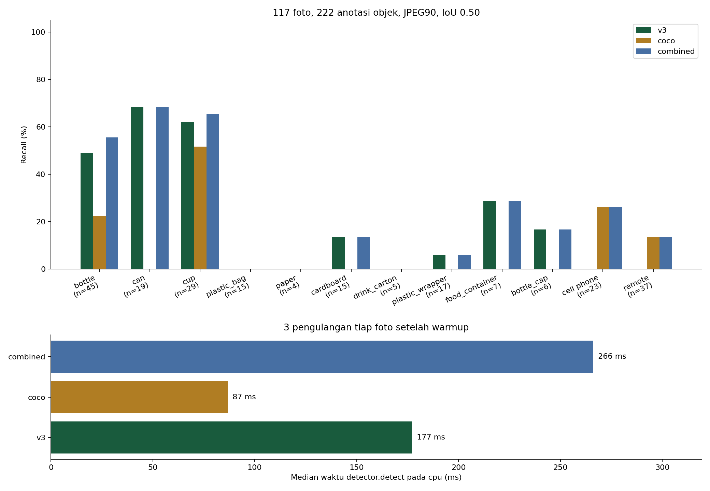

# Benchmark replay kamera v1

7 November 2026. Benchmark membandingkan checkpoint Broad Waste v3, YOLO11n COCO, dan adapter gabungan yang dipakai demo. Daftar foto dan anotasi dibekukan sebelum inference. Hasil lengkap tersedia dalam [laporan perbandingan](../../evaluations/camera-replay-v1-comparison.md), [JSON prediksi dan skor](../../evaluations/camera-replay-v1-comparison.json), serta [CSV kesalahan](../../evaluations/camera-replay-v1-comparison-errors.csv).

## Hasil utama

| Model | Precision | Recall | F1 | Median CPU | P95 CPU |
|---|---:|---:|---:|---:|---:|
| V3 | 59,0% | 26,6% | 36,6% | 177 ms | 215 ms |
| COCO | 75,0% | 16,2% | 26,7% | 87 ms | 104 ms |
| Gabungan | 60,7% | 33,3% | 43,0% | 266 ms | 330 ms |

Pada 222 anotasi input standar, gabungan mendeteksi benar 74 objek, v3 59 objek, dan COCO 36 objek. Precision gabungan lebih rendah daripada COCO, dengan waktu sekitar tiga kali COCO pada CPU yang sama. Pasangan kotak berlabel sama berkurang menjadi nol setelah merge, sedangkan pasangan bertumpuk dengan label berbeda bertambah menjadi 14, dibanding dua pada setiap model tunggal.

Kardus terdeteksi benar 2 dari 15 objek pada v3 dan gabungan. Ponsel terdeteksi benar 6 dari 23 objek pada COCO dan gabungan, sedangkan remote 5 dari 37. Kantong plastik, kertas, dan karton minuman belum mempunyai TP pada sampel standar ini. Hasil tersebut menunjukkan bahwa cakupan gabungan membantu recall keseluruhan, sementara banyak kelas masih mempunyai objek terlewat.

Perbedaan sumber juga besar. Pada 15 foto DrinkingWaste dengan 23 objek, v3 dan gabungan mencapai recall 95,7%. Pada 32 foto TACO dengan 81 objek, recall keduanya 12,3%. Komposisi kelas dan ukuran objek berbeda antarsumber, sehingga selisih tersebut memerlukan analisis per kelas sebelum dikaitkan dengan penyebab tertentu.

Pada transformasi redup, recall gabungan berubah dari 33,3% menjadi 32,4%, dan F1 dari 43,0% menjadi 43,8%. Jumlah FP berkurang dari 48 menjadi 35. Respons ini khusus pada pengurangan brightness yang diterapkan pada sampel tetap.



## Data dan cakupan

Manifest `benchmarks/camera-replay-v1.json` berisi 117 foto, 222 bounding box target, dan 86 kelompok sumber. Setiap gambar mempunyai checksum, kelompok, anotasi, cakupan kelas yang diperiksa, dan metadata sumber. Data mentah memakai lokasi lokal yang tercantum di manifest.

| Sumber | Foto | Pemilihan | Kelas yang dinilai |
|---|---:|---|---|
| DrinkingWaste v2 test | 15 | Tiga gambar berdasarkan hash per kelompok sequence test | bottle, can |
| TACO test pada dataset v3 | 32 | Semua gambar test TACO pada manifest v3 | Sepuluh kelas Broad Waste |
| COCO val2017 | 70 | Kuota 20 phone, 20 remote, 10 bottle, 10 cup, 10 gambar tanpa empat target COCO yang dinilai, berdasarkan hash tetap | bottle, cup, cell phone, remote |

Satu foto dapat memuat beberapa kelas. Setelah seluruh anotasi disertakan, dukungan ponsel menjadi 23 objek dan remote 37 objek. Kardus mempunyai 15 objek, kertas empat objek, dan karton minuman lima objek. Keterbatasan dukungan ini perlu diperhitungkan saat membaca peringkat kelas.

| Kelas utama | Anotasi | Objek berluas kurang dari 1% foto |
|---|---:|---:|
| bottle | 45 | 25 |
| can | 19 | 1 |
| cup | 29 | 11 |
| cardboard | 15 | 2 |
| cell phone | 23 | 13 |
| remote | 37 | 26 |

Komposisi ini mencakup objek yang kecil dan jauh. Performa pada ponsel yang dipegang dekat kamera perlu dibaca bersama pengujian foto close-up tersendiri.

Pemilihan DW membatasi pengulangan sequence. Beberapa foto tetap menampilkan benda fisik yang sama. Sebanyak 117 gambar berkorespondensi dengan 86 kelompok sumber, dan jumlah benda fisik independen memerlukan pencatatan lapangan lebih lanjut.

Kandidat COCO diperiksa terhadap pHash data train/validation v3 serta gambar yang telah dipilih, dengan batas Hamming lima. Pemeriksaan seluruh manifest final juga menemukan nol pasangan dekat terhadap train/validation v3 pada batas tersebut. Foto COCO train yang dipakai pretraining model umum dikeluarkan dari pemilihan benchmark ini. COCO validation tersedia bagi pengembang model pretrained, sehingga hasil benchmark tetap mempunyai keterbatasan independensi terhadap proses pengembangan pretrained.

Anotasi berasal dari penerbit dataset, kemudian diperiksa melalui contact sheet dan pemeriksaan beberapa foto pada resolusi asli oleh Codex. Dua sampel diganti sebelum inference. COCO 76416 menampilkan iklan cetak iPod pada bus, sedangkan COCO 147518 mempunyai cangkir terlihat yang belum masuk anotasi target sumber. Catatan penolakan tersimpan di manifest. Review bounding box oleh manusia independen masih perlu dilakukan.

Metadata lisensi per gambar COCO dipertahankan dari arsip resmi. Seleksi menerima ID lisensi 4 dan 5. Rights TACO mengikuti audit dataset v3, dan metadata DrinkingWaste mengikuti dataset yang telah disiapkan. Rujukan sumber berada pada halaman penerbit COCO dan catatan dataset proyek. [COCO download](https://cocodataset.org/#download), [COCO terms](https://cocodataset.org/#termsofuse), [dataset v3](DATASET_V3.md), [DrinkingWaste](FINE_TUNING.md).

## Protokol

- Kedua checkpoint memakai square 640, confidence inference minimal 0,25 dan NMS IoU 0,70 melalui `YoloDetector.detect` yang digunakan aplikasi.
- Skor operasional memakai kandidat `supported_for_review` dari policy aplikasi, yang pada checkpoint ini mempunyai ambang minimal 0,50. Label Broad Waste tetap mengikuti profil review-only.
- Adapter gabungan menjalankan kedua checkpoint secara nyata, lalu memakai deduplikasi dan mapping versi yang sama dengan demo.
- Input standar memperkecil sisi terpanjang menjadi maksimal 1600 piksel dan mengenkode JPEG quality 90. Pillow bilinear menjadi pendekatan terhadap resize canvas browser.
- Input redup menggunakan faktor brightness 0,55 pada foto yang sama. Transformasi ini menguji sensitivitas terhadap pengurangan kecerahan. Pengukuran kamera fisik dengan pencahayaan berbeda masih perlu dikumpulkan.
- Setiap pasangan gambar/profil diuji pada ketiga mode. Durasi diulang tiga kali setelah dua warmup per mode, dengan urutan model dirotasi untuk setiap foto dan pengulangan.
- Timer mencakup decode, inference, mapping, dan merge di `detector.detect`. Waktu persiapan JPEG, pemuatan model, capture kamera, upload, dan HTTP dicatat sebagai bagian di luar timer detektor.
- CPU yang digunakan Intel Core i7-14700HX. Versi Python, Torch, Ultralytics, jumlah thread, checksum model, dan identitas adapter tersimpan di JSON.

## Perhitungan

Pencocokan precision/recall memakai label yang sama dan IoU minimal 0,50. Prediksi diurutkan berdasarkan confidence. Setiap prediksi dan setiap anotasi hanya dapat dicocokkan sekali. Kotak tambahan dengan kelas yang sama dihitung FP. Objek yang kelasnya belum didukung checkpoint tetap masuk denominator recall.

Precision dihitung sebagai TP / (TP + FP), recall sebagai TP / (TP + FN). Skor keseluruhan memakai jumlah TP/FP/FN seluruh kelas, dan skor per kelas tersedia terpisah. Precision tanpa prediksi disimpan sebagai null. Sumber yang mempunyai anotasi terbatas memakai `evaluated_classes` per foto. Misalnya, prediksi paper pada foto COCO berada di luar cakupan anotasi dan ditandai unscored.

Diagnosis salah label memakai pencocokan geometris terpisah dengan semua kandidat yang bisa dipilih. Karena itu, prediksi refrigerator yang menutupi kardus tetap tercatat sebagai kebingungan kelas meski refrigerator berada di luar kelas precision/recall benchmark. Diagnosis ini memilih satu pasangan berdasarkan IoU dan dapat muncul bersamaan dengan TP dari hipotesis lain. Kolom JSON dan CSV membedakan hitungan skor dari diagnosis ini.

Kotak dobel dilaporkan sebagai jumlah pasangan kandidat berlabel sama dengan IoU minimal 0,65. Pasangan bertumpuk dengan label berbeda dicatat tersendiri. Median dan P95 waktu menggunakan 351 sampel per mode/profil.

## Menjalankan ulang

Environment `.venv-ai` dan bobot lokal harus tersedia. Manifest menyimpan path relatif repository sehingga dapat digunakan kembali pada mesin dengan berkas dataset yang identik. Checksum diverifikasi sebelum inference. Perintah dari root repository berikut menghasilkan JSON, Markdown, grafik PNG, dan CSV kesalahan.

```powershell
.\.venv-ai\Scripts\python.exe scripts/benchmark_camera_models.py
.\.venv-ai\Scripts\python.exe -m pytest tests/test_camera_benchmark.py -q -p no:cacheprovider
```

Untuk menyimpan putaran lain, berikan `--output evaluations/camera-replay-v1-repeat.json`. Gunakan manifest yang sama saat membandingkan perubahan model. `--device` dan `--repeats` tersedia melalui CLI. Perbandingan waktu memerlukan perangkat dan konfigurasi yang sama.

Script persiapan `scripts/prepare_camera_benchmark.py` mendokumentasikan pemilihan deterministik dan memerlukan dataset test v3 serta arsip anotasi COCO yang sudah tersedia. Script menolak menimpa manifest yang sudah dibekukan. Data kamera milik pengguna dapat dievaluasi melalui `--manifest` baru dengan format yang sama, berisi bbox yang diperiksa, checksum, cakupan kelas, dan kelompok sesi pemotretan.

Foto kamera laptop pengguna dari debugging sebelumnya dipisahkan dari agregat benchmark. Hasil pada 117 foto publik ini memberi baseline replay. Evaluasi lapangan masih memerlukan foto baru dari kamera dan benda yang akan dipakai saat demo.

Foto ponsel pengguna juga diperiksa terpisah pada ketiga mode. V3 menghasilkan nol kandidat, sedangkan COCO dan gabungan menghasilkan dugaan remote sekitar skor 0,88. Metadata diagnosis tersimpan di `artifacts/camera-benchmark-personal-diagnostic.json`. Kasus yang sudah dipakai debugging ini tetap di luar agregat 117 foto.

Verifikasi implementasi mencakup 240 tes Python yang lulus dan 34 artifact kontrak yang sesuai. Delapan tes benchmark memeriksa pencocokan satu-ke-satu, kotak dobel, salah kelas, batas anotasi sumber, kandidat yang belum bisa dipilih, penggabungan hitungan, checksum, serta preprocessing. Skor dapat dihitung ulang dari JSON prediksi dengan modul evaluasi lama untuk memeriksa kesesuaian hitungan.
